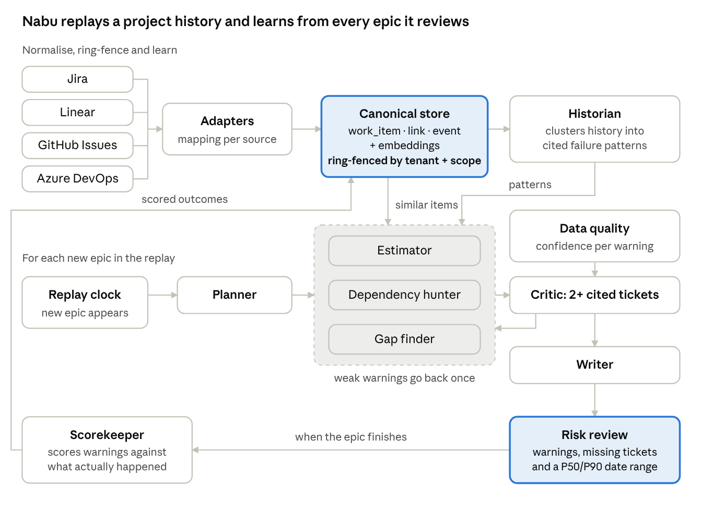

# Nabu: Delivery Risk Reviewer

## Python library

Nabu is also available as the MIT-licensed `nabu-delivery` Python package
(`from nabu import Reviewer, Viewer, WorkItem`). Install from this checkout with
`python -m pip install .`; offline execution needs no API key. See
[the library guide](docs/library.md) and [runnable example](examples/library_quickstart.py).
The package is experimental and has not yet been published to PyPI.

Nabu reads a team's ticket history from any tracker and warns them, before work starts, where a new plan is likely to go wrong.

- **In:** past tickets from Jira, Linear, GitHub Issues or Azure DevOps, normalised into one schema, plus a new epic or sprint plan.
- **Agents:** a historian learns the team's failure patterns; an estimator, a dependency hunter and a gap finder check the new plan; a critic keeps only warnings backed by cited past tickets; a writer produces the review.
- **Long-running:** replays a project's whole history on a simulated clock, reviewing each epic as it appears; a scorekeeper checks predictions against outcomes and the team improves over the run.
- **Ring-fenced:** every record carries a tenant and scope, and agents never see or cite data outside the viewer's scope.
- **Out:** a risk review with cited warnings, suggested missing tickets and a realistic P50/P90 date range.
- **Demo:** a backtest on a real public project. The agents review a past epic using only what was known on day one, then we reveal what actually happened.

Built for the Accel AI Innovate London hackathon (15 Oct 2026), challenge "Long Running Agents: From Task to Workflow".

See [docs/plan.md](docs/plan.md) for the full build plan and [docs/agents.md](docs/agents.md) to run the agents. Moving to a new machine? See [HANDOVER.md](HANDOVER.md).
